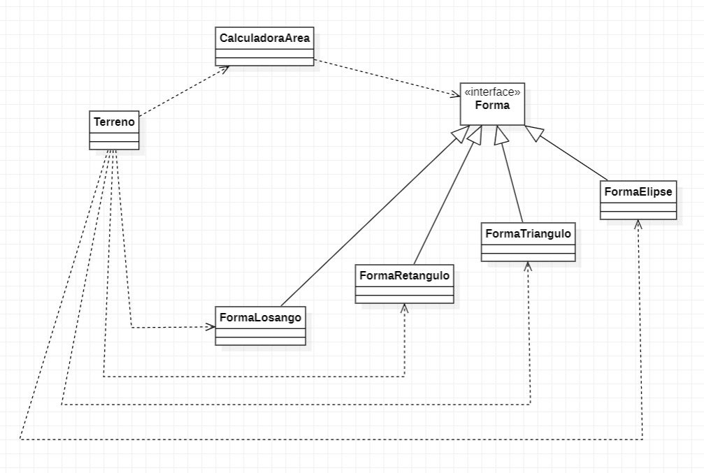

# Exercício Strategy, Cálculo de Área de Terreno
#### Nome: João Vitor Fernandes Ribeiro Carneiro Ramos
#### Matrícula: 202165076C

Implementação do padrão de projeto **Strategy** em Java.

## Diagrama UML

